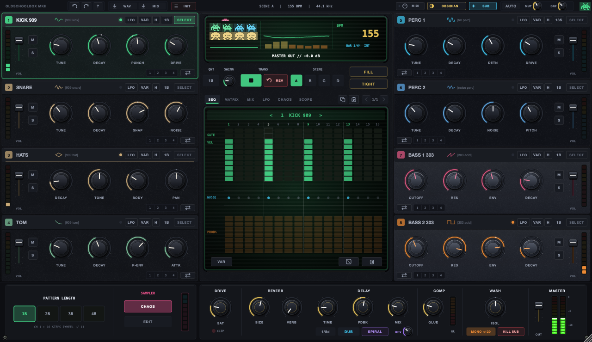

# OldSchoolBox MKII

An 8-channel procedural Acid / Free Tekno groovebox + underground sample chaos bus, built with JUCE 8 as a **cross-platform VST3 / AU plugin and Standalone app (macOS Universal, Windows x64, Linux x86_64 & arm64)**.
All 8 synth and drum voices are synthesized from scratch, paired with an RT-safe Chaos Sample Bus, SpiralFx performance dub unit, 13 hardware skins, and live DJ performance controls.




---

## Architecture

OldSchoolBox supports **multi-output routing**: 1 stereo Main bus plus 8 optional per-voice stereo aux buses (Kick, Snare, Hats, Tom, Perc1, Perc2, Bass1, Bass2) for individual mixing in your DAW, alongside a free-running internal clock (`PLAY`) for Standalone or stopped-DAW jamming.

The audio engine processes in fixed chunks (max 2048 samples) with per-sample parameter smoothing (~10 ms) to eliminate zipper noise during live automation.

Signal chain:

```
8x Voice DSP (Kick, Snare, Hats, Tom, Perc1, Perc2, Bass1, Bass2 303 Diode Ladder)
  --> Equal-power pan + Mono crossover (< 300 Hz / 150 Hz in TIGHT mode)
  --> Per-voice aux stereo buses (1..8) + Sum to Main stereo bus
  --> Master Drive ("Mackie 1202 Redline" 2x oversampled saturation)
  --> Underground Chaos Sample Bus (8 procedural Tekno DNA banks + custom WAV/AIFF, kick-ducked)
  --> Master Delay (stereo, BPM-synced or free, wet HPF @ 250 Hz, kick-ducked, DUB THROW)
  --> Master Reverb (Freeverb plate, wet HPF @ 250 Hz, kick-ducked)
  --> Master Glue Compressor
  --> M/S Mono-Maker (Side HPF @ 120 Hz) + TIGHT 40 Hz low-cut
  --> Bipolar DJ Isolator ("WASH" LP/HP) + Momentary KILL SUB (24 dB/oct HPF @ 150 Hz)
  --> True-Peak Limiter (-0.3 dBTP ceiling)
  --> Output Analyzer (peak/RMS meter, phase-locked CRT scope, 8-band spectrum)
```

Mute/Solo logic is evaluated per voice before rendering.
Muted or non-soloed channels still tick their sidechain envelopes to avoid state drift.

---

## What's New in MKII

### Sound System DSP & Chaos Sample Bus
- **303 Diode Ladder (18 dB/oct)**: asymmetric square shaper, sub-bass resonance compensation, phase-reset on non-slid attacks, and BASS1 (sub/offbeat) vs BASS2 (screaming 303) role split.
- **Anti-click Sidechain**: 1 ms smoothed kick-to-bass ducking.
- **Chaos Sample Bus (`/// CHAOS // SAMPLE BUS`)**: 8 built-in procedural Tekno DNA one-shots (`WHISTLE_98`, `SIREN_23`, `RADIO_GLITCH`, `TRIBE_CHANT`, `SUB_ALARM`, `LASER_ZAP`, `INDUSTRIAL_CLANG`, `RAVE_HOOVER`) plus lock-free custom WAV/AIFF loading (max 8s, drag & drop onto window or `WAV` button), 24 dB/oct 400 Hz HPF + megaphone bandpass, Akai S950 SR reducer/grit, bar-aware triggering, rising-pitch `FILL` stutter, 1/16 Euclidean auto-gate, kick ducking, auto-panning, and `DUB THROW`.
- **Master Sound System Chain**: 2x oversampled Mackie 1202 Drive, M/S Mono-Maker (`MONO <120`), wet HPF @ 250 Hz + kick ducking on Delay and Reverb, Bipolar DJ Isolator (`WASH`), Momentary `KILL SUB` (< 150 Hz), and -0.3 dBTP True-Peak Limiter.

### DJ & Live Performance Controls
- **Snap-Back / Panic Reload (`REVERT` / `V` / `Alt+Scene`)**: `Shift+Click` on `A/B/C/D` saves both sequencer state and all synth/FX knob values; `REVERT` snaps everything back on the next quantized boundary.
- **Quantized Scene & Mute (`QNT: 1B / 1/4 / OFF`)**: queued Mute and Scene buttons flash and snap sample-accurately on the next beat or bar (`Shift+Click` on `M` for instant mute).
- **Spring-Back Tweaking (`Alt+Drag`)**: drag any knob while holding `Alt` and it snaps back to its starting value on release.
- **Surgical Knob Ergonomics**: `Shift+Drag` for fine precision, double-click for musical sweet-spot reset, mouse wheel for instant micro-adjust, and **1-Click MIDI Learn** (`Right-Click` any knob to bind a hardware CC; `Shift+Right-Click` to clear).
- **Swipe-to-Paint Sequencer**: left-drag across steps to paint ON/OFF, right-drag to erase, `Shift+Left-Drag` vertically to draw velocity directly on the pad.
- **True Polyrhythms (`1..64` steps)**: wheel or `Shift`/`Alt+Click` on `LEN` sets exact odd step lengths (e.g. `11S`, `13S`, `15S`), with out-of-loop steps darkened visually.
- **Acid Scale Lock (`PHR23` / `DMIN` / `HYP2` / `DIM`)**: constrains `RND` and `ACID` bass randomizers to underground scales.
- **Full-QWERTY Live Control**: `1`-`8` quantized Mute, `Space` Play/Stop, `F` Fill, `Q`/`W`/`E`/`R` Scenes A-D, `C` Chaos ON/OFF, `K` Kill Sub, `V` Revert, `Cmd+Z` / `Shift+Cmd+Z` Undo/Redo.
- **Direct DAW Drag & Drop (`WAV>` / `MID>`)**: drag directly into Ableton, FL Studio, or Bitwig to export a 4-bar 24-bit WAV loop or multi-channel Drums + 303 Acid MIDI clip with zero save dialogs.

### MKII Hardware UI Craft (60 FPS)
- **13 Hardware Themes (`THEME` — Click: next | Shift+Click: menu)**: `OBSIDIAN`, `TR-909`, `ACID 303`, `CRT-98`, `SPIRAL`, `PIANO LED` (gleuomorphic piano-black gloss), `PORCELAIN` (ceramic white), `GAMEBOY`, `MIAMI 84`, `AMBER 82`, `TOXIC BIO`, `SAKURA`, and `GOLD MK2`.
- **4-Slot Quick Jam Presets (`1 | 2 | 3 | 4` per channel)**: 1-click groove switching per instrument directly on each strip (`Shift+Click` saves custom groove, `Alt+Click` generates a variation).
- **SpiralFx (`SPIRAL` + `DRV`)**: dedicated beat-synced Jet Flanger + 3/16 Gated Decaying Dub Delay + Distortion routed exclusively from `PERC 1`, `PERC 2`, and `CHAOS` (click: 2-beat throw; `Shift+Click`: latch).
- **Beat-Synced Visual FX (`VIZ: OFF / SUB / RAVE`)**: 100% UI-thread reactive lighting (channel trigger halos, performance FX aura, chassis edge sub-bass bars, and animated Space Invaders arcade fleet with UFO Mothership & lasers reacting to bass, mids, and highs).
- **Symmetric 3-Pillar Top Bar & Non-Intrusive Info View**: airgapped native vector icons, DIN 5-pin MIDI Out toggle, and centered hover/telemetry bar aligned over the CRT core.
- **Master Output Fader (`OUT`) + 1176/SSL GR Meter**: dedicated vertical Master fader next to the L/R peak-hold meters, plus Ghost Dots, Live Modulation Rings, and Engineering Units HUD (`55.0 Hz (A1)`, `185 ms`, `+9.0 dB [MACKIE SAT]`).

---

## Voices

### Kick (KickVoice)

- Dual-stage pitch envelope (fast 5 ms snap + slow 60 ms body)
- Sub-oscillator at half frequency, mixed at 30%
- 2x oversampled body oscillator via `fastSin` (parabolic approximation)
- HP-filtered click transient at 3 kHz
- Asymmetric tanh drive with even-harmonic bias
- Output LP filter at 12 kHz (bandwidth limiting)

### Snare (SnareVoice)

- Pitched body oscillator with attack-time pitch sweep
- Band-passed noise: HP at 2 kHz, LP at 10 kHz
- Body and noise mixed, then passed through `fastTanh` saturation
- Output LP filter at 14 kHz

### Hats (HatsVoice)

- Six square-wave oscillators at inharmonic frequency ratios derived from the TR-808:
  `1.0, 1.4471, 1.6818, 1.9265, 2.5028, 3.7594`
- Dual envelopes: fast ring (2 ms) for transient, slow body for sustain
- Band-passed noise layer: HP at 6 kHz, LP at 16 kHz
- Resonant HP filter at 4 kHz on the mixed signal

### Tom (TomVoice)

- Dual-stage pitch sweep: fast component (15 ms) + slow component (60 ms), blended 60/40
- LP-filtered body at 8 kHz for warm analog tone
- HP-filtered click transient at 1.5 kHz
- Exponential body envelope with precomputed coefficient
- `fastTanh` output saturation at 1.2x drive

### Perc1 (Perc1Voice) -- Metallic Percussion

- Two inharmonic sine oscillators with configurable detune ratio
- Ring modulation between the two oscillators (metallic sideband generation)
- Pitch sweep at attack (8 ms decay constant)
- Band-pass filter: HP at 800 Hz, LP at 12 kHz
- Configurable `fastTanh` drive with makeup gain

### Perc2 (Perc2Voice) -- Noise Percussion

- Dual-stage pitch sweep: fast 8 ms + slow 40 ms
- Band-passed noise: HP at 1 kHz, LP at 8 kHz
- Separate noise envelope (decays faster than the tonal component)
- LP-filtered tonal body at 10 kHz
- `fastTanh` output saturation

### Bass1 -- Round Offbeat

- Saw oscillator with sub-oscillator at 30% mix
- 4-pole state-variable LP filter with resonance
- Filter envelope modulation with configurable depth and decay
- Sidechain ducking from kick (configurable amount and release)

### Bass2 -- Acid 303 Clone

Hardware-modeled 303 emulation with the following techniques:

- **HP resonance feedback**: 150 Hz high-pass in the filter feedback loop (nasal resonance character)
- **2x oversampling** on the filter stage with `fastTanh` nonlinearity
- **Component tolerance**: per-stage gain mismatch of 0.5%, seeded per instance
- **Thermal drift**: slow LFO at 0.15 Hz modulating pitch by 2 cents
- **Self-oscillation tuning**: feedback gain calibrated for clean sine at high resonance
- **Accent side-effect**: accent increases filter decay time, not just level
- **Capacitor accumulation**: filter envelope does not reset on legato (charge buildup)
- **Asymmetric slide**: portamento is faster ascending than descending
- **Gate click transient**: 0.5 ms DC bump at note onset
- **VCA bleed**: 0.03% signal leakage when gate is closed
- **Pre-filter drive**: accent-modulated input saturation

---

## Sequencer

Each channel has an independent step sequencer with the following capabilities:

- **Pattern length**: 16, 32, 48, or 64 steps per channel (independent)
- **Per-step velocity**: stored as uint8 (1-127), editable via right-click + vertical drag
- **Swing**: global parameter, implemented as PPQ-based delay on odd 16th notes
- **Page navigation**: patterns longer than 16 steps are viewed in pages of 16, with auto-follow during playback
- **Transport sync**: driven by `AudioPlayHead` PPQ position, fires voices on step boundaries

### 303 Per-Step Attributes (Bass Channels Only)

Each step on Bass1 and Bass2 carries four independent boolean flags, stored as uint64 bitmasks:

| Attribute | Storage | UI Interaction |
|-----------|---------|----------------|
| Slide     | `bassSlide[0..1]` | Click on SLD sub-row |
| Accent    | `bassAccent[0..1]` | Click on ACC sub-row |
| Octave Up | `bassOctUp[0..1]` | Shift+click on ACC sub-row |
| Octave Down | `bassOctDown[0..1]` | Cmd+click on ACC sub-row |

These attributes are serialized with the project and cleared by CLR and INIT.

### Auto-Variation System

Each channel has a VAR toggle. When enabled, the `TransportSync` module automatically
swaps the channel pattern at musical boundaries using presets from `PatternPresets.h`:

- Fills are injected every 16 bars
- Driving variations occur every 4 bars
- The system cycles through 4 pattern sets (A/B/C/D) over a 64-bar phrase

The current bar position is tracked via `Sequencer::currentBar` and displayed in the UI header.

### Smart Randomizer

The RND button generates musically appropriate patterns per channel type:

| Channel | Rule |
|---------|------|
| Kick | Four-on-the-floor base, 15% chance of extra hits on even steps |
| Snare | Beats 2 and 4, 12% ghost notes at velocity 40-80 |
| Hats | Eighth notes with 40% chance of sixteenth-note fills |
| Tom, Perc1, Perc2 | Sparse, 18% density |
| Bass1, Bass2 | 55% note density, auto-generated slide (25%), accent (20%), octave up (15%), octave down (10%) |

---

## Master FX

The master bus applies three stages in series:

### Drive

Waveshaping via `fastTanh` with variable input gain (1x to 7x) and automatic makeup gain.

### Delay

Stereo delay line with configurable feedback (0-90%) and wet/dry mix.
Time source is selectable between free-running (manual time knob) and BPM-synced divisions:

| Sync Setting | Division | Multiplier |
|-------------|----------|------------|
| FREE | Manual | -- |
| 1/4 | Quarter note | 1.0x beat |
| 1/8 | Eighth note | 0.5x beat |
| 1/8d | Dotted eighth | 0.75x beat |
| 1/16 | Sixteenth note | 0.25x beat |
| 1/16d | Dotted sixteenth | 0.375x beat |
| 1/32 | Thirty-second note | 0.125x beat |

Maximum delay buffer: 2 seconds at any sample rate.

### Reverb (PlateReverb)

Freeverb-style plate algorithm: 8 lowpass-feedback comb filters in parallel
followed by 4 allpass filters in series. Delay lengths scaled by the host
sample rate; stereo spread of 23 samples between L and R for a wide, dense
diffusion. SIZE knob maps to comb feedback (0.70 to 0.97); VERB knob is the
wet send into the master bus.

### Compressor (GlueCompressor)

Stereo bus glue compressor with 3 ms attack and 100 ms release. A single
COMP knob maps to threshold (-3 dB to -24 dB), ratio (2:1 to 10:1), and
auto makeup gain (up to +8 dB). Stereo-linked peak detection on `max(|L|,|R|)`
keeps the image stable under heavy compression.

### Limiter

Final-stage `fastTanh` soft limiter on the stereo output. Ensures the signal
never exceeds 0 dBFS regardless of voice count, drive, reverb tail, or delay
feedback accumulation.

### Output Analyzer

Post-limiter tap drives:

- L/R peak meter with 300 ms decay envelope and RMS overlay (30 ms one-pole)
- 8-band spectrum analyzer using Chamberlin SVF bandpasses at 60 / 125 / 250 /
  500 / 1k / 2k / 4k / 8k Hz with 150 ms band-peak envelopes

All analyzer outputs are atomic; the UI repaints them at 20 Hz.

---

## Live Performance (Scenes + FILL)

The top "LIVE" row of the master strip exposes four scene buttons (A/B/C/D)
and a FILL trigger:

- **Click a scene** — queues a switch on the next bar. Active scene is shown
  in neon green; the queued scene pulses in neon cyan.
- **Shift+click a scene** — saves a snapshot of the current sequencer state
  (patterns, velocities, lengths, probabilities, micro-timing, 303 attrs,
  humanize flags) into that scene slot.
- **FILL button** — captures a pre-fill snapshot, plays a 1-bar fill on the
  next bar using PatternPresets set D, then restores the previous state.
  Channels with VAR enabled resume their auto-variation logic.

Scenes are persisted with the DAW project as base64-encoded `Snapshot` blobs.

---

## Organic Performance (Probability + Micro-Timing + Humanize)

Each step carries three independent parameters beyond on/off and velocity:

| Parameter | Storage | Range | Default | UI Gesture |
|-----------|---------|-------|---------|------------|
| Velocity | uint8 atomic | 1-127 | 100 | Right-click + vertical drag |
| Probability | uint8 atomic | 0-100% | 100% | Shift+right-click + vertical drag |
| Micro-Timing | int8 atomic | -50..+50 (% of step) | 0 (on grid) | Cmd+right-click + horizontal drag |

The step-firing engine in `TransportSync` uses a per-channel lookahead model:
each step has a scheduled PPQ time computed as
`nominal_step_ppq + (microtiming / 100) * 0.25 PPQ`. The engine fires any step
whose scheduled time has passed. Probability gates each fire via the
audio-thread RNG (xorshift32). The Humanize (H) toggle per channel applies
a ±15% velocity jitter to each successful fire.

Visualization: probability scales the alpha of the velocity bar
(0.18 .. 1.0 multiplier), and micro-timing translates the bar horizontally
by up to 40% of the cell width.

---

## Euclidean Generator

Right-click on a channel's label area to open a Euclidean rhythm popup:
two sliders (HITS, ROTATE), a live pattern preview, and APPLY. The pattern
length used is the channel's current length (16/32/48/64).

The generator uses a Bresenham/fractional algorithm (one line of math),
which produces patterns indistinguishable from the canonical Bjorklund
distribution for all musically useful (hits, steps) combinations.

---

## Factory Presets

The INIT button is a popup menu. The first entry resets all sequencer
state; the remaining entries load factory snapshots:

- **Detroit Techno** — four-on-the-floor, 16th hats, classic offbeat acid line
- **Acid House** — 4/4 with clap, busy 303 with slides and octaves
- **UK Garage** — broken kick, syncopated bass, shuffled feel
- **Industrial** — 8th-note kick, accented offbeat bass, full hats
- **Minimal** — sparse, hypnotic patterns for slow builds

Each preset is applied to the live state AND mirrored into all 4 scenes,
giving the user a clean starting point per scene slot.

---

## AUTO Mode (cruise control)

A pure-heuristic "cruise control" that lets the sequencer evolve on its own,
designed for 10+ minute live sets where you want hands-off pattern variation
without monotony or chaos.

When you turn AUTO on, the engine snapshots your current state as an **anchor**.
Every bar boundary it mutates the live patterns around the anchor:

- **Per-channel base mutation rates** — kick mutates rarely (0.04 base),
  hats freely (0.28), bass channels in between
- **MUT knob** — global mutation multiplier
- **DRIFT knob** — mean-reversion strength toward the anchor (0 = free walk,
  1 = strong pull back). Maps directly to the `α` of the random-walk equation
  `z_t = (1−α)·z_{t−1} + α·anchor` for each step
- **Energy coupling** — when `sustainedIntensity` is high (the floor is hot),
  mutations are dampened by up to 75%. When the music is quiet, mutations
  run freely
- **Genre-aware bias** — kick on quarter notes and snare on 2/4 reassert
  themselves softly (not forced 1.0, but a 0.45–0.55 probability nudge)
- **Velocity wobble** — small random drift on active step velocities
- **Bass-specific** — slide / accent / octave attributes also mutate at
  35% of the base channel rate

No ML, no dataset, no extra dependencies — pure C++ + xorshift32 RNG.
The full engine is in `core/AutoMode.h` (~120 lines).

## Rave Floor (Visual Feedback)

The plugin pulses with the music. A `VisualState` struct in the audio thread
tracks per-channel fire timestamps (sample-counter based), kick pulses, and
a sustained-intensity accumulator that rises 1/16 per bar of 3+ kick hits
and falls 1/8 per quiet bar.

- **Channel row glow** — each channel's row lights up in its colour for
  ~200 ms after every trigger; the colour strip on the left edge brightens
  and thickens in proportion to the trigger velocity.
- **Step trail** — the four steps behind the playhead leave a fading neon
  magenta comet tail.
- **Energy meter** — top-left of the title bar; gradient green → yellow →
  magenta. Fills as sustained kicks build up.
- **Title glow** — the OLDSCHOOLBOX logo brightens with sustained intensity
  and pulses on every kick.
- **Window border** — a magenta + cyan border appears around the whole
  editor when sustained intensity > 5%, intensifying as the floor heats up.
- **Spectrum bars** — saturation boosted by sustained intensity; a white
  highlight appears on the top of bars above 80%.

After 16 bars of solid 4/4 the entire UI is glowing — exactly the
Korg Electribe / "muro di suono" vibe.

## TIGHT Master Toggle

A single toggle in the LIVE row, Elektron-style:

- Lowers the per-voice mono-fold crossover from 300 Hz to 150 Hz (tighter low end)
- Applies a one-pole master high-pass at 40 Hz to clean up sub-rumble
- Soft-blends 85% of the HP signal with 15% of dry for character

One click to make the master "ready to play out".

## MIDI Output

When the MIDI toggle (in the LIVE row) is enabled, the plugin emits MIDI
note-on/off events alongside its audio output:

- Drum voices write to channel 10 (GM drum standard) using their canonical
  notes (kick=36, snare=38, hats=42, tom=45, perc1=48, perc2=50)
- Bass voices write to channels 1 and 2 with their pitched note (C3 base
  + per-step octave shifts)

Note-offs are queued and emitted before the next note on the same channel,
and flushed when transport stops. Useful for sequencing external hardware
in lockstep with the internal voices.

---

## UI Controls

### Per-Channel Controls

| Control | Function |
|---------|----------|
| Step cells | Left-click to toggle note on/off |
| Velocity | Right-click (or Alt+click) + drag vertically on active step |
| Volume knob | Channel output level (automatable) |
| Pan knob | Stereo position, equal-power law |
| M button | Mute toggle (red when active) |
| S button | Solo toggle (yellow when active; exclusive with other channels) |
| CLR button | Clear all steps on this channel |
| RND button | Smart randomize (musical rules per channel type) |
| C button | Copy pattern to clipboard |
| P button | Paste clipboard pattern to this channel |
| VAR button | Enable auto-variation (yellow glow when active) |
| Length button | Cycle pattern length: 1B/2B/3B/4B (16/32/48/64 steps) |
| Page arrows | Navigate pattern pages when length > 16 |
| Param knobs | Per-voice synthesis parameters (tune, decay, drive, etc.) |

### Bass Sub-Rows

Bass channels display two additional thin rows below the main step grid:

- **SLD**: slide toggles per step (orange when active)
- **ACC**: accent/octave toggles per step (magenta = accent, cyan = octave up, purple = octave down)

### Header

- BPM display (read from DAW transport)
- Bar counter showing position within the 64-bar auto-variation cycle
- Swing knob (0 = straight, 1 = maximum shuffle)

### Master Strip

Top row (LIVE):

- Scene buttons A/B/C/D (click = queue, shift-click = save)
- FILL button (1-bar fill on next bar, then restore)
- MIDI toggle (send drum/bass note events on channels 10/1/2)
- INIT button (popup menu: clear + 5 factory presets)

Bottom row (master FX + analyzer):

- DRIVE knob: master bus saturation amount
- SIZE / VERB knobs: reverb size and wet send
- COMP knob: glue compressor amount (single-knob threshold/ratio/makeup)
- TIME / FDBK / MIX knobs: delay time, feedback, wet/dry
- SYNC button: cycles delay time divisions (FREE, 1/4, 1/8, 1/8d, 1/16, 1/16d, 1/32)
- OUT meters: L/R peak with RMS overlay
- SPEC: 8-band spectrum (60 Hz - 8 kHz, log-spaced)

---

## MIDI Routing

Drum voices respond to note-on messages on any MIDI channel (except channels 1 and 2,
which are reserved for bass). Bass voices are monophonic and respond to note-on/note-off.

| MIDI Note | Voice |
|-----------|-------|
| 36 (C2) | Kick |
| 38 (D2) | Snare |
| 42 (F#2) | Hats |
| 45 (A2) | Tom |
| 48 (C3) | Perc1 |
| 50 (D3) | Perc2 |
| Ch 1, any note | Bass1 |
| Ch 2, any note | Bass2 |

---

## State Persistence

All sequencer state is saved and restored with the DAW project:

- Step patterns (uint64 bitmasks per channel)
- Per-step velocities (64 bytes per channel, base64)
- Per-step probabilities (64 bytes per channel, base64)
- Per-step micro-timing (64 bytes per channel, base64)
- Pattern lengths
- Auto-variation, Mute, Solo, Humanize flags
- 303 attributes (slide, accent, octave up, octave down per bass channel)
- Scene snapshots (4 full Snapshot blobs)
- All synthesis and FX parameters (via JUCE AudioProcessorValueTreeState)

---

## DSP Implementation Notes

All oscillators and filters use approximated math for real-time performance:

- `fastSin`: parabolic sine approximation with correction term (max error < 0.001)
- `fastTanh`: Pade approximant, clamped at +/-3 (max error < 0.001 for |x| < 3)
- `NoiseGen`: xorshift32 PRNG, deterministic per seed
- All filter coefficients are precomputed in `prepare()` or `trigger()`, not per sample
- Denormal protection via `juce::ScopedNoDenormals` in `processBlock`

---

## Build

Requirements: macOS, Xcode Command Line Tools, CMake 3.22 or later.

```bash
git clone --recurse-submodules https://github.com/fabriziosalmi/oldschoolbox.git
cd oldschoolbox
cmake -B build -DCMAKE_BUILD_TYPE=Release
cmake --build build --config Release -j$(sysctl -n hw.logicalcpu)
```

The plugin is installed automatically to:

- `~/Library/Audio/Plug-Ins/VST3/OldSchoolBox.vst3`
- `~/Library/Audio/Plug-Ins/Components/OldSchoolBox.component`

---

## Project Structure

```
src/
  PluginProcessor.cpp/h    Main audio processor, processBlock, state serialization
  PluginEditor.cpp/h       Top-level UI (title bar, master strip, step grid)
  Sequencer.h              Step patterns, velocities, 303 attrs, mute/solo, clipboard

  core/
    BusLayout.h            Voice indices, MIDI note mapping constants
    MidiRouter.h           Stateless MIDI-to-voice dispatcher
    TransportSync.h        DAW sync, step advancement, scenes/fill, auto-var, MIDI out
    VoiceBank.cpp/h        Owns all 8 voices, render/trigger interface
    ParamLayout.cpp/h      APVTS parameter definitions
    ParamIds.h             Compile-time parameter ID strings
    PatternPresets.h       Factory patterns for auto-variation sets
    Scenes.h               Snapshot struct + capture/apply (4 scenes + FILL)
    FactoryPresets.h       5 factory preset Snapshots (Detroit/Acid/UKG/Industrial/Minimal)
    Euclidean.h            Bresenham/fractional Euclidean pattern generator
    PlateReverb.h          Sample-rate-invariant Freeverb plate reverb
    GlueCompressor.h       Single-knob bus glue compressor (65 Hz SC-HPF RMS + Peak)
    OutputAnalyzer.h       Peak + RMS meter + Phase correlation + 8-band SVF spectrum
    ChaosSampleBus.h       RT-safe async WAV/AIFF loader + Tekno DNA sample bus
    SpiralFx.h             Beat-synced Jet Flanger + 3/16 Gated Dub Delay + Drive
    BeatLfo.h              Per-channel beat-synced 32-bar LFO bank
    LoopExporter.h         Atomic 2-pass seamless 4-bar WAV & MIDI exporter
    ChannelPatternPresets.h 4-slot quick jam pattern presets per channel

  voices/
    DspConstants.h         Math constants, fastSin, fastTanh, NoiseGen
    KickVoice.h            Kick drum synthesis
    SnareVoice.h           Snare drum synthesis
    HatsVoice.h            Hi-hat synthesis (6-oscillator)
    TomVoice.h             Tom drum synthesis
    Perc1Voice.h           Metallic percussion (ring modulation)
    Perc2Voice.h           Noise percussion
    BassVoice.h            303-style bass synthesizer

  ui/
    StepGrid.cpp/h         Step grid, channel controls, 303 sub-rows, prob/timing gestures
    SpaceLookAndFeel.h     Custom dark-theme rendering for all widgets
    ParamPanel.h           Per-channel parameter knob grouping
    EuclideanPopup.h       CallOutBox popup for Euclidean rhythm generation
```

Source: ~30 files, approximately 5000 lines of C++.

---

## License

MIT -- see [LICENSE](LICENSE).
